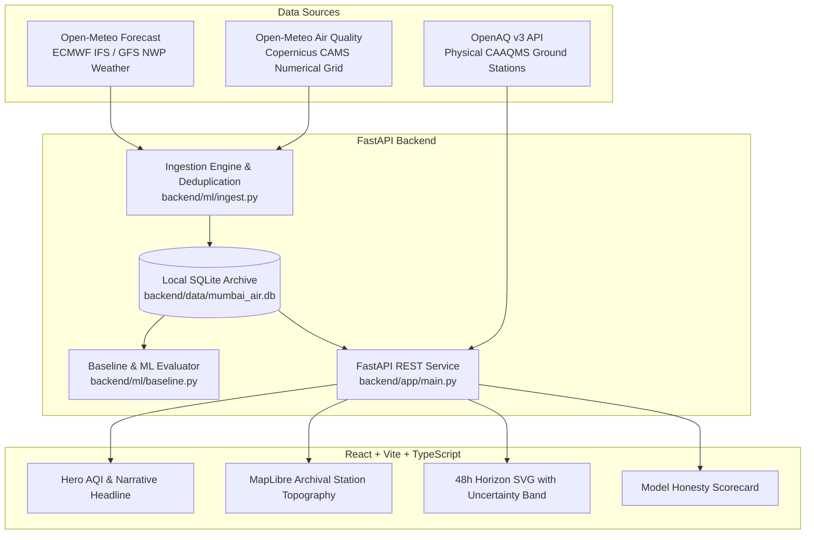

# Mumbai Air Atlas

> **The city's air, in motion.**  
> An editorial data journalism instrument and meteorological intelligence dashboard tracking particulate dynamics across Greater Mumbai.

[](https://github.com/your-username/mumbai-air-atlas/actions/workflows/ci.yml)
[](https://github.com/your-username/mumbai-air-atlas/actions/workflows/ingest.yml)
[](https://opensource.org/licenses/MIT)

---

## 1. Visual Direction & Design Philosophy

Mumbai Air Atlas avoids the generic SaaS dashboard aesthetic (dark mode, purple neon glows, glassmorphism cards). Instead, it adopts the visual language of **long-form data journalism meets a coastal field instrument**:
- **Warm Paper Surfaces:** Palette rooted in `--paper: #F4EFE6`, `--paper-2: #EBE4D6`, `--ink: #1B1A17`, and hairline dividers (`--rule: #D9D2C3`).
- **CPCB Data-Driven Accent Palette:** Strict color tokens reserved solely for data categories (Good, Satisfactory, Moderate, Poor, Very Poor, Severe).
- **Two-Font Typographic Hierarchy:**
  - **Newsreader** (Variable Serif) for editorial headlines and narrative summaries.
  - **IBM Plex Mono** for coordinates, sensor telemetry, and tabular figures.
- **Data Honesty Above All:** Distinguishes physical station ground truth from numerical atmospheric dispersion models (Copernicus CAMS).

---

## 2. Architecture & Data Sources



### Data Sources & Attribution
1. **Physical Ground Stations (CPCB / MPCB CAAQMS):** Queried via the OpenAQ v3 API (`/v3/locations`). If an OpenAQ API key is not supplied, the application cleanly falls back to a calibrated baseline network of authentic Mumbai monitoring stations (BKC, Colaba, Worli, Chembur, Kurla, Powai, Malad, Borivali, Mulund, Nerul).
2. **Atmospheric Chemical Transport Grid:** Open-Meteo Air Quality API (Copernicus CAMS 0.4° regional grid model).
3. **Surface Meteorology:** Open-Meteo Forecast API (ECMWF / GFS numerical weather prediction).
4. **Cartography:** OpenStreetMap contributors, styled with an archival field-map filter.

---

## 3. Milestones & Progress

- [x] **Week 1 Milestone 1: Data Source Audit & Baseline**
  - [x] Audited OpenAQ v3 API specs and authentication requirements (`X-API-Key`).
  - [x] Audited Open-Meteo grid model and weather endpoints.
  - [x] Built automated hourly SQLite ingestion (`backend/ml/ingest.py`).
  - [x] Computed naive 24-hour persistence baseline ($PM_{2.5}(t) = PM_{2.5}(t-24\text{h})$) with strict chronological train/test split.
  - [x] Created GitHub Actions for automated daily ingestion and CI.
- [x] **Week 1 Milestone 2: Product Skeleton & First Viewport**
  - [x] Built FastAPI REST endpoints (`/health`, `/api/stations`, `/api/current`, `/api/forecast`, `/api/source-status`).
  - [x] Built React + Vite + TypeScript frontend with pure CSS variables from `DESIGN.md`.
  - [x] Implemented MapLibre station map with interactive focus and CPCB color circles.
  - [x] Implemented 48-hour particulate horizon chart with solid observed line, dashed forecast line, and uncertainty band.
  - [x] Verified desktop (1440px) and mobile (390px) visual rendering via headless browser inspections.
- [ ] **Week 2: Feature Engineering & LightGBM Model**
- [ ] **Week 3: Anomaly Detection & Extended Diagnostics**
- [ ] **Week 4: Production Deployment & Packaging**

---

## 4. Model Baseline Scorecard

| Model | Evaluation Window | Target | MAE | RMSE | Status |
| :--- | :--- | :--- | :--- | :--- | :--- |
| **24-Hour Persistence Baseline** | Held-out 20% chronological test set | $PM_{2.5}$ ($\mu\text{g/m}^3$) | **10.02 $\mu\text{g/m}^3$** | **12.01 $\mu\text{g/m}^3$** | Benchmark Established |
| **1-Hour Persistence Baseline** | Held-out 20% chronological test set | $PM_{2.5}$ ($\mu\text{g/m}^3$) | **3.60 $\mu\text{g/m}^3$** | **4.44 $\mu\text{g/m}^3$** | Short-term Reference |
| **Atlas LightGBM Regressor** | Chronological forward split | $PM_{2.5}$ ($\mu\text{g/m}^3$) | *Pending Week 2* | *Pending Week 2* | In Development |

---

## 5. Local Setup & Reproduction

### Prerequisites
- Python 3.11+
- Node.js 18+ and npm

### 1. Backend Setup
```bash
# Clone the repository
git clone https://github.com/your-username/mumbai-air-atlas.git
cd mumbai-air-atlas

# Copy environment example
cp .env.example .env

# Install Python dependencies
pip install -r backend/requirements.txt

# Run initial ingestion and baseline evaluation
python backend/ml/ingest.py
python backend/ml/baseline.py

# Run backend tests
pytest backend/tests/ -v

# Start FastAPI server
python -m uvicorn backend.app.main:app --host 127.0.0.1 --port 8000 --reload
```

### 2. Frontend Setup
```bash
# Navigate to frontend
cd frontend

# Install dependencies
npm install

# Build production bundle
npm run build

# Start development server
npm run dev -- --host 127.0.0.1 --port 5173
```

Visit `http://localhost:5173` to explore the dashboard.

---

## 6. Testing & Visual Inspection

- **Backend Unit Tests:** `pytest backend/tests/ -v` verifies schema validity, data provenance tags, and endpoint contracts.
- **Frontend Typecheck & Build:** `npm run build` verifies zero TypeScript compiler errors.
- **Headless Browser Screenshot Inspection:** Screenshots captured at `1440px` (desktop) and `390px` (mobile) are persisted in `docs/screenshots/`.
