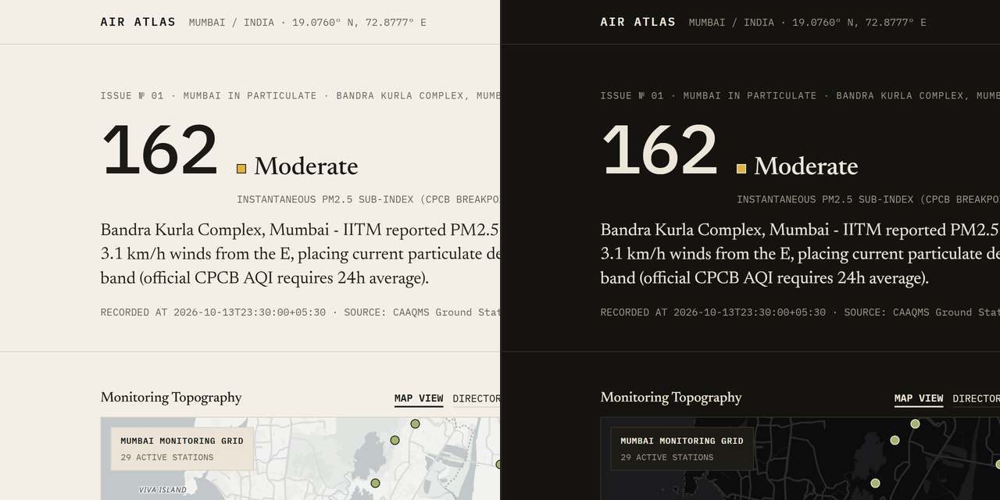
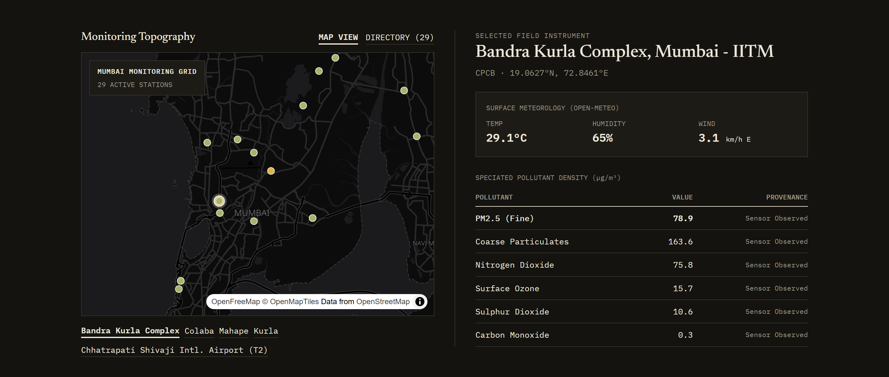
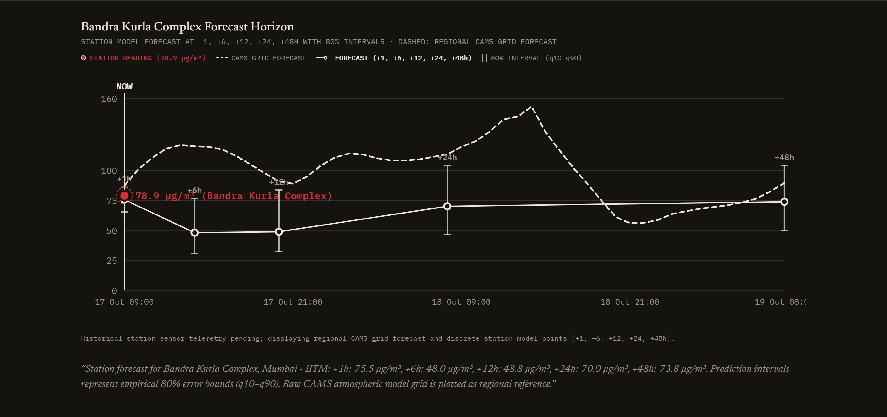
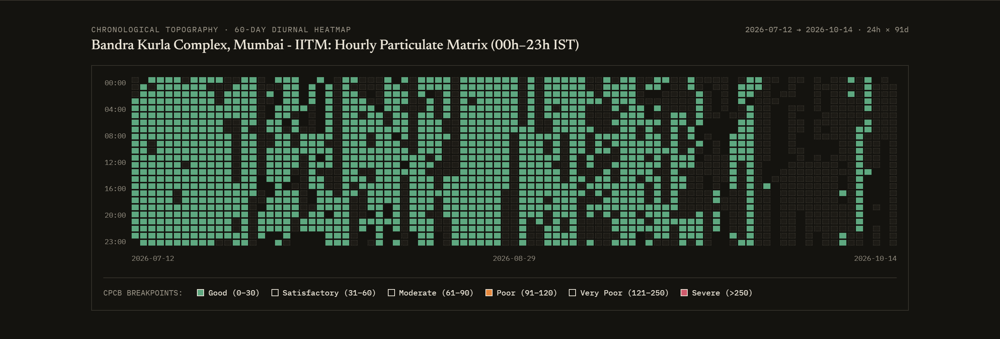
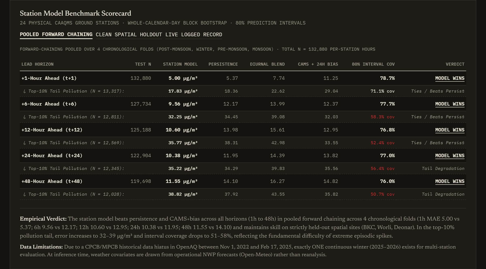
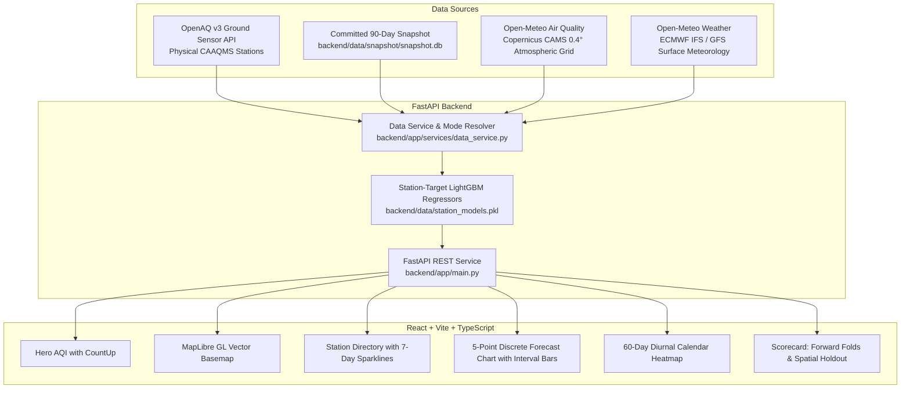

# Mumbai Air Atlas

> **The city's air, in motion.**  
> A coastal meteorological instrument and physical particulate forecasting system tracking atmospheric dynamics across Greater Mumbai.

[](https://python.org)
[](https://typescriptlang.org)
[](https://fastapi.tiangolo.com)
[](https://opensource.org/licenses/MIT)



---

## Zero-Configuration Clone-and-Run

Mumbai Air Atlas is completely self-contained. The repository includes a **frozen 90-day physical snapshot archive** (`backend/data/snapshot/`) and pre-trained station-target gradient-boosted models (`station_models.pkl`, 5.3 MB). **No API keys, accounts, or signups are required to clone and run.**

```bash
# 1. Clone repository
git clone https://github.com/your-username/mumbai-air-atlas.git
cd "Weather Prediction"

# 2. Install dependencies
pip install -r backend/requirements.txt
npm --prefix frontend install

# 3. Launch services
# Terminal 1: Backend REST API (port 8000)
python -m uvicorn backend.app.main:app --host 127.0.0.1 --port 8000

# Terminal 2: Frontend Dev Server (port 5173)
npm --prefix frontend run dev
```

Open [http://localhost:5173](http://localhost:5173) in your browser. The application will immediately boot in **Snapshot Mode** (`data as of 14 Oct 2026`), serving physical sensor readings, NWP surface weather, 60-day calendar heatmaps, 7-day sparklines, and 48-hour model forecasts.

*(Optional)* To switch to live streaming mode, generate a free API key at [openaq.org](https://openaq.org) and set `OPENAQ_API_KEY=your_key` in `backend/.env`.

---

## 1. Overview & System Tour

Mumbai Air Atlas is an open-source environmental instrument and meteorological dashboard tracking fine particulate matter ($PM_{2.5}$) across Greater Mumbai. Rather than relying solely on coarse numerical atmospheric dispersion grids, the platform trains directly on physical ground monitors across Mumbai's CAAQMS network (CPCB/MPCB/IITM-SAFAR).

### Monitoring Topography & 7-Day Sparklines

*Vector basemap rendering Mumbai's coastal CAAQMS network alongside directory listings with inline 7-day sparkline trajectories (168 hourly points).*

### 48-Hour Station-Target Forecasts with Empirical Error Bounds

*Direct LightGBM predictions at $+1, +6, +12, +24, +48\text{h}$ with empirical 80% prediction intervals ($q10\dots q90$) centered on the station trajectory, plotted alongside raw Copernicus CAMS atmospheric grid forecasts as regional reference.*

### Chronological Topography (60-Day Diurnal Heatmap)

*Hour-of-day ($00\text{h}\dots 23\text{h}$ IST) by date matrix colored by official CPCB AQI breakpoints, revealing seasonal shifts and nighttime thermal inversion buildups.*

### Empirical Scorecard & Model Diagnostics

*Comprehensive forward-chaining scorecard, spatial holdouts on unseen stations, weather ablation, and tail performance disclosures.*

---

## 2. Visual Direction & Design Philosophy

Mumbai Air Atlas rejects generic SaaS templates (dark neon glows, 3D tilt cards, gradient text) in favor of the aesthetic of **long-form data journalism meets a coastal field instrument** (see `DESIGN.md`):

- **Dual Edition Surfaces:**
  - **Day Edition:** Warm newsprint tones (`--paper: #F4EFE6`, `--paper-2: #EBE4D6`, `--ink: #1B1A17`, `--rule: #D9D2C3`).
  - **Night Edition:** Night broadsheet (`--paper: #14130F`, `--paper-2: #1D1B16`, `--ink: #EDE7DA`, `--rule: #34312A`) with high-contrast CPCB category tokens ($\ge 4.5:1$).
- **Editorial Typography:**
  - **Newsreader** (serif) for headlines, narrative analysis, and diurnal context.
  - **IBM Plex Mono** for coordinates, sensor telemetry, sparklines, and tabular metrics.
- **Cartography:** High-performance vector tile rendering via MapLibre GL with dedicated web worker bundling.
- **Scientific Honesty Above All:** Zero border-radius, zero gradients, hairlines only. The UI strictly discloses data provenance, separates physical station targets from model grids, and reports where the model loses.

---

## 3. Architecture & Data Sources



---

## 4. Empirical Evaluation Results

The station forecasting pipeline is evaluated on physical station targets across **24 candidate CAAQMS monitoring locations** in Greater Mumbai. Evaluation uses strict chronological forward-chaining across four seasonal folds, clean spatial holdouts on unseen station groups, and **whole-calendar-day block bootstrap 95% confidence intervals** ($B = 500$, resampling all stations on a calendar day together).

### Table 1: Forward-Chaining Evaluation Pooled Across All 4 Folds ($N = 132,880$ per-station hours)
*Evaluated chronologically across Fold 1 (Post-Monsoon Oct–Nov 2025), Fold 2 (Winter Dec 2025–Feb 2026), Fold 3 (Pre-Monsoon Mar–May 2026), and Fold 4 (Monsoon Jun–Sep 2026).*

| Lead Horizon | Samples ($N$) | Station Model MAE | Persistence MAE | Diurnal Blend MAE | CAMS + 24h Bias MAE | 80% Prediction Interval Coverage |
| :---: | :---: | :---: | :---: | :---: | :---: | :---: |
| **$+1\text{h}$** | 132,880 | **5.00 $\mu\text{g/m}^3$** | 5.37 | 7.74 | 11.25 | **78.7%** |
| *↳ Top-10% Tail* | 13,327 | *17.83 $\mu\text{g/m}^3$* | *18.36* | *21.99* | *29.04* | *71.1%* |
| **$+6\text{h}$** | 127,734 | **9.56 $\mu\text{g/m}^3$** | 12.17 | 13.99 | 12.37 | **77.7%** |
| *↳ Top-10% Tail* | 12,821 | *32.25 $\mu\text{g/m}^3$* | *34.45* | *38.93* | *32.03* | *58.3%* |
| **$+12\text{h}$** | 125,188 | **10.60 $\mu\text{g/m}^3$** | 13.98 | 15.61 | 12.95 | **76.8%** |
| *↳ Top-10% Tail* | 12,567 | *35.77 $\mu\text{g/m}^3$* | *38.31* | *43.34* | *33.55* | *52.4%* |
| **$+24\text{h}$** | 122,904 | **10.38 $\mu\text{g/m}^3$** | 11.95 | 14.39 | 13.82 | **77.0%** |
| *↳ Top-10% Tail* | 12,348 | *35.22 $\mu\text{g/m}^3$* | *34.29* | *39.54* | *35.56* | *56.4%* |
| **$+48\text{h}$** | 119,698 | **11.55 $\mu\text{g/m}^3$** | 14.10 | 16.27 | 14.82 | **76.0%** |
| *↳ Top-10% Tail* | 12,030 | *38.82 $\mu\text{g/m}^3$* | *37.92* | *43.90* | *35.82* | *50.7%* |

---

### Table 2: Clean Spatial Holdout ($N = 7,886$ hours, Unseen Stations)
*Trained strictly prior to June 1, 2026 on 20 non-held-out locations; tested on held-out site groups: **Bandra Kurla Complex (BKC)**, **Worli**, and **Deonar** (Jun 1 – Sep 30, 2026).*

| Horizon | Samples ($N$) | Station Model MAE | Ablation (No CAMS) | Persistence MAE | Diurnal Blend MAE | CAMS + Bias MAE | $\Delta$ vs Best Baseline [95% Calendar-Day CI] | 80% Coverage | Top-10% Tail MAE | Top-10% Coverage |
| :---: | :---: | :---: | :---: | :---: | :---: | :---: | :---: | :---: | :---: | :---: |
| **$+1\text{h}$** | 7,886 | **3.57 $\mu\text{g/m}^3$** | 3.56 | 3.77 | 6.08 | 6.19 | **$-0.21$** $[-0.25, -0.17]$ (vs Persist) | 71.0% | 7.91 $\mu\text{g/m}^3$ | 63.3% |
| **$+6\text{h}$** | 7,514 | **5.92 $\mu\text{g/m}^3$** | 5.92 | 7.55 | 10.37 | 6.69 | **$-0.77$** $[-1.28, -0.34]$ (vs CAMS+B) | 71.4% | 17.06 $\mu\text{g/m}^3$ | 51.9% |
| **$+12\text{h}$** | 7,293 | **5.95 $\mu\text{g/m}^3$** | 6.01 | 7.81 | 11.43 | 6.74 | **$-0.80$** $[-1.18, -0.40]$ (vs CAMS+B) | 74.6% | 17.80 $\mu\text{g/m}^3$ | 52.2% |
| **$+24\text{h}$** | 7,123 | **5.76 $\mu\text{g/m}^3$** | 5.93 | 6.39 | 10.19 | 7.28 | **$-0.64$** $[-0.94, -0.38]$ (vs Persist) | 77.0% | 17.01 $\mu\text{g/m}^3$ | 59.0% |
| **$+48\text{h}$** | 6,887 | **6.48 $\mu\text{g/m}^3$** | 6.77 | 7.52 | 11.87 | 7.80 | **$-1.04$** $[-1.51, -0.54]$ (vs Persist) | 74.7% | 18.92 $\mu\text{g/m}^3$ | 55.8% |

---

### Feature Ablation: Does Weather and CAMS Matter?
- **Weather Features:** Removing surface weather inputs costs approximately $0.3\dots 0.7\,\mu\text{g/m}^3$ MAE (~5% relative). Weather awareness provides steady physical regularization across land-sea breeze inversions, though persistence and local lags remain the primary driver at short lead times.
- **Future CAMS Dispersion ($c_{t+h}$):** Dropping future CAMS changes nowcast MAE ($+1\text{h}\dots +6\text{h}$) by $\le 0.07\,\mu\text{g/m}^3$. At extended horizons ($+24\text{h}\dots +48\text{h}$), dropping CAMS increases MAE by $+0.9\dots 1.8\,\mu\text{g/m}^3$, confirming synoptic guidance adds value once autocorrelation fades.

---

## 5. Critical Methodological Disclosures & Limitations

> [!IMPORTANT]
> 1. **Single Continuous Winter of Station Telemetry:** Due to an external data gap in OpenAQ between November 1, 2022 and February 17, 2025 where zero CPCB/MPCB records exist across Mumbai, exactly **ONE continuous winter (Winter 2025–2026)** is present in modern station records. Multi-winter station-target validation cannot be asserted until additional seasons elapse.
> 2. **Top-10% Tail Degradation & Under-Coverage:** During extreme episodic pollution events (the top 10% highest pollution hours), model MAE increases significantly ($32\dots 39\,\mu\text{g/m}^3$ pooled), and empirical 80% interval coverage drops to $51\dots 58\%$. Tree ensembles cannot extrapolate beyond training leaves, leading to conservative predictions during unprecedented spikes.
> 3. **Input Distribution Mismatch (Reanalysis vs Operational Forecasts):** During historical model training and evaluation, CAMS concentrations and weather covariates are drawn from reanalysis archives. At live inference, inputs are supplied by forward-running operational NWP forecasts (Open-Meteo), which inherently carry higher variance and forecast uncertainty.
> 4. **Instantaneous AQI Sub-Index:** The displayed Air Quality Index is an **instantaneous PM2.5 sub-index** using official CPCB breakpoints calculated on hourly concentrations. Official statutory CPCB AQI mandates a 24-hour time-weighted average.
> 5. **Unvalidated Physical Sensors:** OpenAQ measurements reflect raw telemetered CAAQMS readings from statutory agencies (CPCB/MPCB/IITM) without independent laboratory cross-calibration, drift corrections, or zero-audits.

---

## 6. Development & Test Suite

```bash
# Run pytest test suite (9 passing tests verifying endpoints, schemas, lags, and models)
python -m pytest

# Run frontend TypeScript typecheck and Vite build
npm --prefix frontend run build

# Regenerate retina screenshots and social preview asset
python docs/take_screenshots.py
```

---

## License

MIT License. Designed and developed with scientific rigor for Greater Mumbai.
