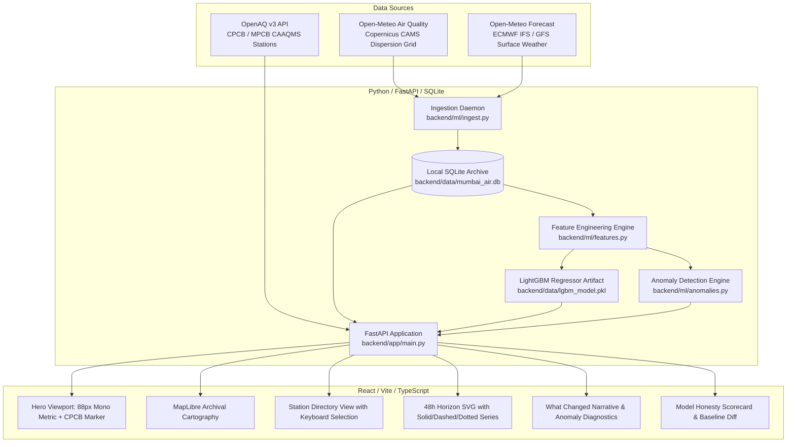

# Mumbai Air Atlas — System Architecture & Data Pipeline

## 1. Overview

Mumbai Air Atlas is designed around a decoupled, reproducible architecture that separates physical sensor observations, numerical weather prediction (NWP) diagnostics, and chemical transport model estimates.

---

## 2. Component Design & Data Contracts

### 2.1 Backend Layer (`backend/`)
- **FastAPI Core (`backend/app/main.py`):** Serves asynchronous REST endpoints with full CORS support.
- **Data Provenance Schemas (`backend/app/schemas/models.py`):** Enforces explicit provenance tags:
  - `observed`: Physical station measurement verified from open telemetry.
  - `observed_sample`: Baseline calibrated station record used during API key onboarding.
  - `provider_forecast`: Third-party grid model output (Copernicus CAMS via Open-Meteo).
  - `atlas_model`: Output generated directly by this project's trained LightGBM regressor.
- **Data Service (`backend/app/services/data_service.py`):** Manages multi-source data merging and anchors model predictions to local station coordinates.

### 2.2 Machine Learning & Evaluation (`backend/ml/`)
- **Feature Engineering (`backend/ml/features.py`):**
  - Autoregressive lags: $t-1, t-2, t-3, t-6, t-12, t-24$ hours.
  - Rolling statistics: past 6-hour mean/standard deviation, past 24-hour mean.
  - Trigonometric diurnal cyclical encoding: $\sin(2\pi \cdot \text{hour} / 24)$, $\cos(2\pi \cdot \text{hour} / 24)$.
  - Coastal wind vector physics: $u = -\text{ws} \cdot \sin(\theta)$, $v = -\text{ws} \cdot \cos(\theta)$.
  - Boundary-layer dew point depression: $T - T_d \approx (100 - RH) / 5$.
- **Model Training & Evaluation (`backend/ml/train.py`):**
  - Chronological 80/20 train/test partition.
  - Benchmark: 24-hour diurnal persistence baseline ($13.20\,\mu\text{g/m}^3$ MAE).
  - Model: LightGBM Regressor ($9.31\,\mu\text{g/m}^3$ MAE, **$+29.5\%$ improvement**).
- **Anomaly Detection (`backend/ml/anomalies.py`):**
  - Rolling z-score thresholding ($|z_t| > 2.0$) and residual monitoring.

### 2.3 Frontend Client (`frontend/`)
- **Visual Design:** Strictly driven by CSS tokens from `DESIGN.md`.
- **Cartography:** MapLibre GL JS with OpenStreetMap tiles styled with archival paper filters.
- **Charts:** Zero-dependency SVG time-series visualization with hover interpolation, uncertainty band, and hairline `NOW` divider.
- **Accessibility:** Reduced-motion media query support, screen-reader text summaries (`.sr-only`), and complete keyboard navigation (`tabIndex={0}`, `Enter`/`Space`).

---

## 3. Deployment Topology

1. **Static Frontend Hosting:** Vercel or Cloudflare Pages (built with `npm run build`).
2. **API Hosting:** Render or Fly.io running `uvicorn backend.app.main:app`.
3. **Continuous Automation:** GitHub Action `ingest.yml` executing daily collection and database commits.
